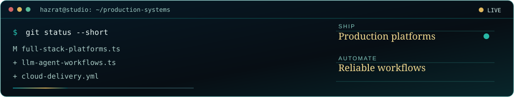
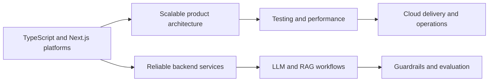
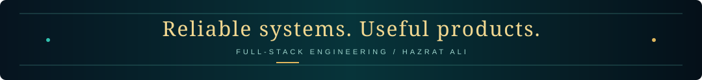

<!-- HAZRAT ALI - GitHub profile README -->
<!-- Visual direction: midnight navy, teal, and gold editorial engineering studio. -->

<div align="center">

  <a href="https://github.com/HazratAli-pixel">
    
  </a>

  <br/>

  

  <p>
    
    
    
  </p>

  

  <p>
    
    
    
  </p>

  

  

  <br/>

<a href="https://www.linkedin.com/in/hazrat-ali/"></a>
<a href="https://github.com/HazratAli-pixel?tab=repositories"></a>
<a href="mailto:tomhazratali@gmail.com"></a>

</div>

## 👨‍💻 About Me

I'm **Hazrat Ali**, a full-stack developer and JavaScript AI & backend engineer based in **Dhaka, Bangladesh**. I have **4+ years of professional experience** building production systems for e-commerce, marketing, and brand platforms, including remote collaboration with a Tokyo-based team.

I work across frontend architecture, backend services, data workflows, LLM-powered product features, testing, deployment, production support, code review, and developer mentoring. My earlier work in digital publishing, IT support, research, and event coordination also shaped how I communicate, organize work, and collaborate across teams.

```typescript
const hazrat = {
  location: "Dhaka, Bangladesh",
  currentRole: "Full Stack Developer - Ninja Digital Innovations",
  previousRole: "Software Engineer (L1) - Brand Cloud Inc.",
  experience: "4+ years",
  building: ["Full-stack platforms", "REST APIs", "LLM workflows"],
  strengths: ["Technical leadership", "Mentoring", "Production delivery"],
  cloud: ["AWS", "Cloudflare", "Docker"],
  principle: "Reliable systems. Useful products.",
};
```

<div align="center">
  
</div>

---

<div align="center">


  
  
  
  
  

</div>

### 📊 Professional Snapshot

| Area                             | Evidence from my work                                                                                           |
| :------------------------------- | :-------------------------------------------------------------------------------------------------------------- |
| **Full-Stack Engineering**       | React 19, Next.js, TypeScript, Node.js, REST APIs, GraphQL, and data-backed applications                        |
| **AI Product Engineering**       | Gemini and Llama integrations, RAG, agent workflows, embeddings, semantic retrieval, and cited answers          |
| **Performance & Quality**        | Lazy loading, code splitting, Webpack optimization, state management, Cypress E2E testing, and code review      |
| **Cloud & Operations**           | AWS, Cloudflare Pages/Workers, Docker, CDN/caching, DNS, deployment, and production support                     |
| **Leadership**                   | Architecture improvements, technical decisions, mentoring, stakeholder communication, and engineering standards |
| **Communication & Coordination** | Digital publishing, research and curation, IT support, seminar logistics, and cross-functional teamwork         |

---

## 🚀 Featured Projects

<div align="center">


</div>

<table align="center" border="0" cellpadding="18" cellspacing="0">
<tr>
<td width="50%" valign="top">
  <div align="center">
    
    <h3>Knowledge Link AI</h3>
    
  </div>
  <blockquote><strong>Private document Q&amp;A</strong> with semantic retrieval and source-grounded LLM answers.</blockquote>
  <table>
    <tr><td>✦</td><td>Document ingestion, metadata, embeddings, and vector storage</td></tr>
    <tr><td>✦</td><td>Agent decisions for retrieval, tool calls, and response generation</td></tr>
    <tr><td>✦</td><td>Citations, refusal guardrails, and quality evaluation</td></tr>
  </table>
  <br/><div align="center"></div>
</td>
<td width="50%" valign="top">
  <div align="center">
    
    <h3>Corporate CMS Platform</h3>
    
  </div>
  <blockquote><strong>Headless CMS</strong> powering two live corporate marketing and brand websites.</blockquote>
  <table>
    <tr><td>✦</td><td>Pages, posts, media, navigation, and reusable content blocks</td></tr>
    <tr><td>✦</td><td>Draft, review, publish, versioning, and scheduling workflows</td></tr>
    <tr><td>✦</td><td>LLM-assisted drafting, translation, summaries, and SEO</td></tr>
  </table>
  <br/><div align="center"><a href="https://brandcloud.co.jp/"></a> <a href="https://solution.brandcloud.co.jp/"></a></div>
</td>
</tr>
<tr><td colspan="2"></td></tr>
<tr>
<td width="50%" valign="top">
  <div align="center">
    
    <h3>MoeGuide (モエガイド)</h3>
    <p><code>Apr 2024 - Oct 2024</code></p>
    
    <br/>
     
  </div>
  <blockquote><strong>Personalized tour-guide platform</strong> for cultural, cosplay, sightseeing, and photo experiences across Tokyo, Kanagawa, and Chiba.</blockquote>
  <table>
    <tr><td>✦</td><td>Developed and maintained reliable, type-safe APIs with tRPC</td></tr>
    <tr><td>✦</td><td>Built real-time chat between guides and users with Pusher</td></tr>
    <tr><td>✦</td><td>Delivered responsive Next.js interfaces and conducted code reviews</td></tr>
    <tr><td>✦</td><td>Translated client requirements into clear technical direction as a bridge engineer</td></tr>
  </table>
  <br/><div align="center"></div>
</td>
<td width="50%" valign="top">
  <div align="center">
    
    <h3>Suirikyou (水利協)</h3>
    <p><code>Aug 2023 - Mar 2024</code></p>
    
    <br/>
      
  </div>
  <blockquote><strong>Certification and compliance platform</strong> for the Japan Water Facilities Environment Hygiene Association.</blockquote>
  <table>
    <tr><td>✦</td><td>Integrated and managed dynamic platform content through MicroCMS</td></tr>
    <tr><td>✦</td><td>Implemented Stripe subscriptions, recurring billing, and access control</td></tr>
    <tr><td>✦</td><td>Developed responsive Next.js interfaces and RESTful APIs</td></tr>
    <tr><td>✦</td><td>Aligned technical delivery with client requirements and deadlines</td></tr>
  </table>
  <br/><div align="center"></div>
</td>
</tr>
<tr><td colspan="2"></td></tr>
<tr>
<td width="50%" valign="top">
  <div align="center">
    
    <h3>Report Tool</h3>
    
  </div>
  <blockquote><strong>Brand protection reporting</strong> for monitoring online presence and changes over time.</blockquote>
  <table>
    <tr><td>✦</td><td>REST API integration and responsive user workflows</td></tr>
    <tr><td>✦</td><td>Product-aligned interface components</td></tr>
    <tr><td>✦</td><td>End-to-end validation of critical user flows</td></tr>
  </table>
  <br/><div align="center"></div>
</td>

</tr>
</table>

<details>
<summary><strong>🧪 More public projects and experiments</strong></summary>

| Project                                                                                     | What it demonstrates                                                      | Stack                                     |
| :------------------------------------------------------------------------------------------ | :------------------------------------------------------------------------ | :---------------------------------------- |
| [**JSON to TOON Formatter**](https://github.com/HazratAli-pixel/json_to_toon_formater)      | Bilingual JSON conversion interface with validation and copy support      | React · Vite · JavaScript                 |
| [**Laptop Reseller Marketplace**](https://github.com/HazratAli-pixel/Laptop_resaler_client) | Authentication, wishlists, reporting, role-based dashboards, and payments | React · React Query · Firebase · Stripe   |
| [**Open Learning Platform**](https://github.com/HazratAli-pixel/Open-Learning-client)       | Course discovery, purchasing, verification, and social login              | React · Tailwind CSS · Firebase · Node.js |
| [**Pharmacy Management System**](https://github.com/HazratAli-pixel/pms)                    | Customers, medicines, inventory, stock status, and operational records    | PHP · SQL · Bootstrap                     |

</details>

---

## 💼 Professional Journey

###  Ninja Digital Innovations

`Dhaka, Bangladesh` · `Jun 2025 - Present`

- Lead architecture improvements with TypeScript, React 19, and Next.js
- Design REST APIs and multi-step LLM workflows for product, order, and campaign data
- Improve application performance, state management, SQL queries, and system reliability
- Own delivery from requirements and testing through Docker deployment on AWS and production support
- Mentor junior developers, review code, and contribute to technical decisions and standards

###  Brand Cloud Inc.

`Remote - Japan` · `Mar 2023 - May 2025`

- Delivered Japanese client platforms including **MoeGuide** and **Suirikyou** with Next.js and TypeScript
- Developed type-safe tRPC APIs and real-time Pusher chat for guide-to-user communication
- Integrated MicroCMS content workflows and Stripe subscriptions with recurring billing and access control
- Built responsive interfaces and REST APIs aligned with Japanese client requirements
- Conducted code reviews and worked as a bridge engineer, translating requirements into technical direction

###  NTV

`Part-time` · `Remote` · `Apr 2020 - Feb 2023`

- Researched and curated job listings from multiple portals for accurate, timely job-news content
- Wrote and published structured articles for NTV's digital platform
- Assisted the IT team with technical tasks across editorial and operational work

###  NTV

`Part-time` · `On-site - Karwan Bazar, Dhaka` · `Nov 2018 - Mar 2020`

- Sourced and analyzed listings to identify newsworthy job opportunities
- Produced clear content for NTV's digital and broadcast platforms
- Published timely coverage aligned with current job-market trends

###  Power Station

`Part-time` · `On-site - Dhaka, Bangladesh` · `May 2017 - Sep 2019`

- Planned events and activation campaigns across educational institutions
- Coordinated seminar schedules, logistics, and on-ground support
- Collaborated with teams to deliver smooth operations and positive participant experiences

---

## 🎓 Education

<div align="center">

| Degree                                      | Institution                              |   Period    |     Result      |
| :------------------------------------------ | :--------------------------------------- | :---------: | :-------------: |
| **B.Sc. in Computer Science & Engineering** | Daffodil International University, Dhaka | 2018 - 2022 | GPA 3.32 / 4.00 |

</div>

---

## 🎯 Current Goals & Roadmap



### 🔥 In Progress

- Building production full-stack systems at **Ninja Digital Innovations**
- Developing LLM integrations and agent-style workflows with Gemini and Llama
- Improving performance, data quality, testing, and operational reliability
- Mentoring developers and strengthening code-review and delivery standards

### ✨ Looking Ahead

- Deepen system-design practices for scalable backend and data workflows
- Expand evaluation and observability around AI-assisted product features
- Improve repeatable cloud delivery, testing, and production support workflows
- Document engineering decisions and share practical development knowledge

---

## WakaTime Analytics (Office work)

<p align="center" >
  <a href="https://wakatime.com/@hazratAli">
    
  </a>
</p>

## 📊 GitHub Analytics (Personal git Profile)

<div align="center">


<br/><br/>


</div>

---

## 🤝 Let's Connect

<div align="center">

[](https://www.linkedin.com/in/hazrat-ali/)
[](https://github.com/HazratAli-pixel)
[](mailto:tomhazratali@gmail.com)
[](https://twitter.com/Hazrat369ali)

<br/>

### "Build reliable systems. Make them useful."

Open to full-stack engineering, JavaScript AI, backend-focused roles, and meaningful product collaboration.

<p>
  
  
</p>


<br/>



</div>
